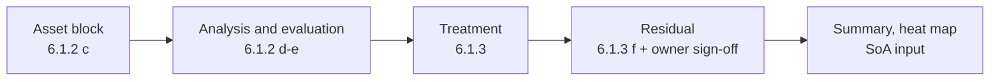

# Project — Odoo ERP and ISO 27001

## TL;DR

Our team, **Prost**, planned the Odoo ERP and ISO 27001 project as an evidence exercise, not a document exercise. The deliverable is a risk register (эрсдэлийн бүртгэл) for a real ERP deployment: every information asset rated for confidentiality, integrity and availability; every threat and vulnerability written in plain language; a computed score; a treatment decision with a named Annex A control, a risk owner and a responsible person; and a residual score the owner signs. The LAB-10 workbook supplies the mechanism — a 27-column register on clauses 6.1.2 and 6.1.3, with a worked e-commerce row we used as the Odoo template.

## Why it matters

An ERP concentrates a whole organisation's data behind one application boundary. One weak configuration puts customer records, the order pipeline and staff accounts in the same blast radius. That is what an ISMS (мэдээллийн аюулгүй байдлын менежментийн тогтолцоо) makes visible and defends with evidence.

The project tests the question the exam never lets you dodge: which controls apply to this system, and how do you prove it? A paragraph saying "we protect our data" proves nothing. A row naming an asset, a vulnerability, a control, an owner, a date and a residual score is auditable.

## Background

The project brief itself could not be read — it is a scan, and the Validation block says so.

What *is* readable is the practical workbook that carries the method: `sem10/Seminar10_Prost.xlsx`, a LAB-10 training artefact for the same course, module 4. It demonstrates how a risk register is kept under ISO/IEC 27001:2022 (MNS ISO/IEC 27001:2023) clauses 6.1.2 (risk assessment) and 6.1.3 (risk treatment), using 50 information assets across three sectors: health (17), education (17) and business (16). Every row is a synthetic training example, containing no real organisation's assets, systems or audit results.

## How it works

### The register is five blocks, not one long list

| Block | Columns |
|---|---|
| A — asset (6.1.2 c) | №, sector, sub-sector, asset, type, classification, C, I, A, value |
| K — threat and vulnerability | threat, vulnerability, weakness found by the assessment |
| N — analysis (6.1.2 d–e) | impact, likelihood, score, level, decision |
| S — treatment (6.1.3) | risk owner, variant, Annex A control, responsible person |
| W — residual (6.1.3 f) | residual impact, likelihood, score, level, approval date |

### The scoring scheme

The workbook's grading sheet makes the arithmetic explicit — the part students most often get wrong.

| Step | Rule |
|---|---|
| Asset value | rate confidentiality, integrity and availability 1–3 each; value = max(C, I, A): 3 → High, 2 → Medium, 1 → Low |
| Score | impact × likelihood |
| Level thresholds | 1–6 Low, 7–12 Medium, 13–25 High |
| Decision | Low may be accepted; Medium needs treatment; High needs treatment first |

Likelihood runs 1 (very rare — once a year or less) to 5 (constant — daily). Impact runs 1 (no noticeable effect) to 5 (credibility, trust or reputation damaged). The scale also carries a personal-data column (at 5, sensitive data exposed and criminal liability) and a financial column, from about 0 to more than 50 million tugrik. The workbook notes that the financial band is set by the organisation's own risk management procedure — the thresholds are a local decision, and the formulas update when they change.

### Four treatment variants

Clause 6.1.3 a gives four ways to treat a risk: **Mitigate / Modify** (add a control that lowers likelihood or impact), **Transfer / Share** (contract, insurance, outsourcing), **Avoid** (stop or change the activity that creates the risk), and **Accept / Retain** (formally accepted by the owner when it falls within the criteria).

### A worked row for an online shop — the Odoo template

Row 3 is the closest analogue to an ERP deployment, and shows the expected quality of writing.

| Field | Value |
|---|---|
| Asset | customer orders and payment data store; data; Confidential; C 3, I 3, A 2 → High |
| Threat | SQL injection |
| Vulnerability | the web app does not validate user input |
| Weakness found | a scan showed SQL injection was possible via the search field |
| Evaluation | impact 5.0, likelihood 3.0 → score 15 → High → treatment needed |
| Treatment | Mitigate; owner: executive director; controls 8.28 secure coding, 8.8 technical vulnerabilities, 8.24 cryptography; responsible: development team lead |
| Residual | impact 5.0, likelihood 1.0 → score 5 → Low; owner approval date |

Note the three-column discipline in the middle: *threat* is what could happen, *vulnerability* is the weakness that makes it possible, and *weakness found by the assessment* is the evidence — only the third proves anything.

Row 48 shows the same method on a different system — the point-of-sale system and card terminal of a small retailer: Confidential, C 3 I 3 A 3, scored 15 and High; the weakness is that the POS terminals share a network with the public Wi-Fi; the treatment selects 8.20 network security, 8.22 segregation of networks and 8.7 protection against malware, with the network engineer responsible; the residual drops to 4.

### What the summary tells you

The summary sheet proves the register's worth: it counts risks per sector before and after treatment and draws the heat map from the register's own cells.

| Sector | Risks | High | Medium | Average score | Residual High | Residual Medium | Residual Low |
|---|---|---|---|---|---|---|---|
| Health | 17 | 1 | 1 | 11.5 | 0 | 0 | 2 |
| Education | 17 | 0 | 2 | 10.5 | 0 | 0 | 2 |
| Business | 16 | 7 | 9 | 12.5625 | 0 | 1 | 15 |
| Total | 50 | 8 | 12 | 12.25 | 0 | 1 | 19 |

Initially 16% of risks are High and 24% Medium, with none Low. After treatment no risk remains High, one is Medium and 19 are Low. Seven of the eight initial High risks sit in the business sector — the finding that justifies an ERP project. The heat map plots likelihood against impact and colours each cell by band: 1–6 green, 7–12 yellow, 13–25 red.

## In practice

Start the Odoo register by copying the discipline, not the content. Write one row per information asset the ERP holds — its data store, configuration, log, integration endpoint — and rate it. Then let the assessment argue: the weakness column must cite a scan, a test or an observation, not a hunch.

Two habits separate a register that works from one that does not. Freeze the thresholds before you start, so scores are comparable; and never let an owner edit a formula cell, because the summary recomputes from it and a hand-typed score corrupts every downstream number.

## Hands-on steps

1. **List the ERP's information assets,** one row each, with type and classification.
2. **Rate C, I and A 1–3** and take the maximum — the value follows from it, not judgement.
3. **Write threat, vulnerability and assessment evidence as three sentences.**
4. **Score with the formula** impact × likelihood, then read the level from the threshold table.
5. **Pick a treatment variant and name the Annex A control,** the owner and the responsible person.
6. **Recompute the residual** after the control, and record the owner's approval date.
7. **Summarise before and after** by sector, and put the heat map before management.

## Pitfalls & gotchas

- **Treating the worked examples as real.** The workbook states all 50 rows are synthetic; none is a finding about a real organisation.
- **Editing the white formula cells.** The workbook marks yellow-and-blue cells as editable input and white-and-black as formula; overwriting a formula breaks the summary silently.
- **Moving the thresholds to make a number look better.** They belong in the organisation's own risk management procedure, and the register formulas update to match.
- **Writing a threat with no evidence.** "Unauthorised access" is a category; "the scan showed SQL injection was possible via the search field" is a finding.
- **Letting the owner accept a High risk silently.** Acceptance must be recorded with the owner's approval date, not inferred from an empty cell.
- **Stopping at the initial score.** The register's value is the before-and-after column, and the residual is what the audit will ask for.

## Exam pointers

- Know what 6.1.2 and 6.1.3 require, and how the register's five blocks map to them.
- Know the scoring chain: C/I/A 1–3, value = max, score = impact × likelihood, thresholds 1–6 / 7–12 / 13–25.
- Know the four treatment variants of 6.1.3 a and when each applies.
- Know a good weakness statement versus a good threat statement.
- Know why the owner approval date is part of the row, not optional.
- Know what the summary and heat map are for, and what the comparison shows.

## Key takeaways

- The deliverable is evidence, not description: one row per information asset.
- Every row runs asset → analysis → treatment → residual, ending with the owner's signature.
- Scores are computed, thresholds are local, formula cells are never overwritten.
- A threat without assessment evidence is a hypothesis, not a finding.
- Treatment is one of four variants, each with a named Annex A control and owner.
- The before-and-after summary converts a register into a decision for management.

## Related

- [[IS-Governance/Lectures/ISO27001|Lec 6-7 — ISO 27001]]
- [[IS-Governance/Lectures/Risk Management|Lec 8-9 — Risk Management]]
- [[IS-Governance/IS Governance & Management|IS Governance & Management]]

## Validation

**Local sources read:**

- `~/Documents/3rdyear/course-work/IS-Governance/sem10/Seminar10_Prost.xlsx` — five sheets: Заавар (instructions, the A–E fill method, the colour legend, the warning that all rows are synthetic, the source list), Эрсдэлийн бүртгэл (the 50-row register, its 27 column headers, the five worked rows and the business rows used above), Хураангуй (per-sector counts, the shares and the heat map with its colour bands), Шалгуур (level thresholds, the likelihood and impact scales including the personal-data and financial columns, the CIA valuation rules, the four treatment variants, the classification and asset-type lists), and Салбарын жишээ (sub-sector names and their register counts).

**External authorities:** none retrieved. The ISO/IEC 27001:2022, 27002:2022 and 27005:2022 references and the ISO URL in the workbook's source list are quoted from that local file only; no standard text was opened.

**Looked at but not readable:** `~/Documents/3rdyear/course-work/IS-Governance/БД төсөл_ Odoo ERP-ISO27001 26-27А.pdf` extracts 6 characters — a scan. It is not cited above and its contents are not described.

## Эх материал

![[teacherspdf/IS-Governance/Project-Odoo-material.pdf]]
