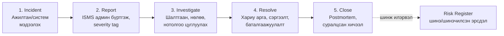

# 6. Инцидент менежмент (Даалгавар 6)

## Уүргийн урсгал (workflow)

Ослын хариу үйл ажиллагааны 5 үе шаттай диаграм — Odoo **Project** app-ын kanban stage-ээр хэрэгжүүлэв (Community Edition-д Helpdesk модуль байхгүй тул ижил үүрэгтэй механизмаар):

| Stage | Юу болох | Хэн | Annex A |
|---|---|---|---|
| Incident | Ажилтан эсвэл систем эвдрэл илрүүлж, карт үүсгэнэ | Аливаа ажилтан (Discuss мэдэгдэх сувгаар ч болно) | A.6.8, A.5.24 |
| Report | ISMS админ бүртгэж, severity tag (low/med/high/critical) өгч, эзэмшигч томилно | ISMS админ | A.5.24 |
| Investigate | Шалтгаан, нөлөөсөн хөрөнгө, нотолгоо (chatter, auditlog хавсралт) | Эзэмшигч | A.5.25, A.5.28 |
| Resolve | Хариу арга хэрэгжүүлж, сэргээж, дахин шалгана | Эзэмшигч + ISMS | A.5.26 |
| Close | Postmortem бичилт; давтагдсан шинж бол risk register-ийн шинэ мөр болно | ISMS админ | A.5.27 |

## Odoo-д хэрэгжүүлэлт (скриншот S10–S11)

- **Project → "Incident Response"** нэртэй шинэ project
- Stages: `Incident` · `Report` · `Investigate` · `Resolve` · `Close`
- Tags: `severity-low`, `severity-medium`, `severity-high`, `severity-critical`
- Карт дээр: эзэмшигч (assignee), deadline, chatter-д нотолгоо, checklist-ээр үйлдлүүд
- Жишээ incident: "R7 phishing тест — 2 ажилтан холбоос дарсан" карт бүхэл урсгалаар дамжина (demo script-д)

## SLA зорилт (бодлогын хэмжигдэхүйц зорилттой уялсан)

| Severity | Report хүртэл | Resolve зорилт |
|---|---|---|
| Critical | 1 цаг | 4 цаг (RTO-тай ижил) |
| High | 4 цаг | 1 ажлын өдөр |
| Medium | 1 ажлын өдөр | 7 хоног |
| Low | 7 хоног | дараагийн sprint |
