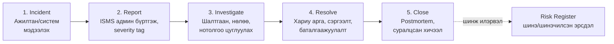

**Даалгаврын товч.** Энэхүү тайланд shoppy.mn (хийсвэр Монгол цахим худалдааны платформ)-ын
ISMS-ийг Odoo 18 Community орчинд бодитоор хэрэгжүүлсэн ажлыг тайлбарлав.
Даалгавар бүр Odoo дахь бодит тохиргоогоор нотлогдоно — дэлгэцийн зургууд
хавсралтад (Бүлэг 11) эмхэтгэв.

**Орчны мэдээлэл:** Odoo 18 Community (Docker image `odoo:18`), PostgreSQL 16 (`postgres:16`),
database `shoppy`, URL http://localhost:8069. Суулгасан нэмэлт: OCA `auditlog` (server-tools 18.0),
`auth_totp`. Community Edition-ийн хязгаарлалт тухайд: Documents ба Helpdesk нь Enterprise-only
тул хөрөнгийн бүртгэлийг Maintenance/Inventory-аар, ослын урсгалыг Project kanban-аар орлуулсан —
өнөөдрийг хүртэл энэ нь курсын дүрэмд нийцнэ.

# 1. Байгууллагын танилцуулга ба нөхцөл байдал (Clause 4)

## 1.1 Байгууллагын товч танилцуулга

**"Shoppy.mn" ХХК** — Монголын хамгийн том цахим худалдааны платформ гэж тооцогдох хийсвэр байгууллага. Компани нь B2C загварын онлайн дэлгүүр бөгөөд харилцагчид вэбсайт болон гар утасны аппликацээр дамжуулан бараа захиалж, төлбөрөө төлбөрийн гарц (payment gateway)-аар хийж, хүргэлтийн түншүүдээр бараагаа хүлээн авдаг.

**Үйл ажиллагааны гол процессууд:**

- Бүтээгдэхүүний каталоги ба агуулахын удирдлага
- Захиалга хүлээн авах, боловсруулах, хүргэлтэд шилжүүлэх (order-to-delivery)
- Төлбөр хүлээн авах — төлбөрийн гарцын API-аар (картын мэдээлэл компанид хадгалагддаггүй)
- Харилцагчийн үйлчилгээ, буцаалт, санал гомдол
- Хүргэлтийн түншүүдтэй мэдээлэл солилцох (хаяг, утасны дугаар)

**Боловсруулдаг мэдээллийн төрлүүд:**

| Өгөгдлийн төрөл | Жишээ | Мэдрэмтгийк |
|---|---|---|
| Харилцагчийн хувийн мэдээлэл | нэр, утас, имэйл, хүргэлтийн хаяг | Өндөр — хувийн мэдээлэл |
| Захиалгын түүх | юу, хэдээр, хэзээ авсан | Дунд |
| Төлбөрийн бичилт | гүйлгээний дугаар, статус (картын дугааргүй) | Өндөр |
| Ажилтны мэдээлэл | нэвтрэх эрх, үүрэг, гүйцэтгэл | Дунд |
| Түншүүдийн гэрээ | төлбөрийн гарц, хүргэлт, cloud | Дунд |
| Техникийн өгөгдөл | каталоги, үнэ, нөөц | Бага–дунд |

**Тохирох хууль, стандарт:** Хувийн мэдээлэл хамгаалах тухай хууль (2021), Цахим худалдааны тухай хууль, MNS ISO/IEC 27001:2023 (ISO/IEC 27001:2022-тай ижил).

## 1.2 Гадаад болон дотоод асуудлууд (Clause 4.1)

PESTLE аргаар гадаад орчны зургаан хүчнийг судлав. Анхаарах хэрэг: PESTLE бол стандартын шаардлага биш, асуудлыг бүтэцтэйгээр тодорхойлох арга — хүчнэл бүр нэг хяналт (control) эсвэл шийдвэрт хүрэх үед л ач холбогдолтой.

| Хүчин | МАБ-д үзүүлэх нөлөө | Хариу хяналт |
|---|---|---|
| **P** — улс төрийн | Гадаад cloud, төлбөрийн гарц, хүргэлтийн түншүүдээс хамааралтай; гадаад дүрэм өөрчлөгдвөл нийлүүлэлт тасалдана | Гэрээний нөхцлийг үеэрэн хянах; өгөгдлөө гаргаж авах exit strategy |
| **E** — эдийн засгийн | Cloud-ын зардал валютаар → төгрөгийн уналт шууд нөлөөлнө; улиралын оргил ачаалалд саатал = орлогын алдагд | Эрсдэлд суурилсан төсөв; тогтмол load testing; багтаамжийн дээд хязгаар |
| **S** — нийгмийн | Харилцагч нууцлал, найдвартай хүргэлт шаарддаг; хуурамч "хүргэлтийн" phishing итгэлыг үгүй хийнэ | Ажилтны сургаль; ил тод нууцлалын мэдэгдэл |
| **T** — технологийн | Вэб/апп/API/cloud-ын эмзэг байдал, буруу тохиргоо → өгөгдөл алдагдах, төлбөрийн статус таарахгүй байх | MFA, нөхөөс, лог хяналт; хяналт бүрийг бодлогын шийдвэртэй уялуулах |
| **L** — хуулийн | Хувийн мэдээлэл цуглуулах үндэслэл, зөвшөөрөл, хадгалах хугацаа; түншийн үүрэг гэрээнд | Хуулийн үндэслэл, хадгалах хугацаа, хандах эрх — "хууль бол баримтжсан хариуцлага" |
| **E** — байгалийн | Цас, үер, цахилгаан тасралт; агуулах/оффис/холболтын саатал | Генератор, UPS, нөөц холболт, off-site backup, саатлын үеийн харилцагчийн мэдэгдлийн журам |

**Эрэмбийн логик:** технологи ба хуулийн хүчин нууцлал буюу бүрэн бүтэн байдалд шууд нөлөөлнө (өгөгдөл задрах, төлбөрийн бичилт өөрчлөгдөх ёсгүй); эдийн засаг ба байгалийн хүчин нь саатлаар дамжин бэлэн байдалд нөлөөлнө. Тиймээс эхлээд өгөгдөл ба төлбөрийн бүрэн бүтэн байдлыг хамгаалж, саатлын эрсдэлийг тасралтгүй байдлын төлөвлөгөөгөөр шийднэ.

## 1.3 Дотоод байдал — SWOT

| | Түлхүүр хүчин | Сонгосон шийдэл |
|---|---|---|
| **S** | Төвлөрсөн захиалгын систем; картын өгөгдөл хадгалдаггүй | Лог ба хандах эрхийг нэг дор төвлөрүүлэх |
| **W** | MFA хэсэгчилэн нэвтэрсэн; restore test тогтмол бус | MFA-г 100%-д хүргэх |
| **O** | Управдаг cloud аюулгүй байдлын үйлчилгээ; улиралын илүү сайн удирдлага | Managed security, сайжруулсан гэрээнүүд |
| **T** | Phishing, DDoS, ransomware | Төлбөрийн сегментлэл, тусгаарлагдсан backup |

Дараалал санаатай: эхлээд MFA + хандах эрх, дараа нь нотлох restore test.

## 1.4 Сонирхогч талууд (Clause 4.2)

| Тал | Шаардлага ба хяналт | Нөлөө |
|---|---|---|
| Хэрэглэгч | нууцлал, зөв захиалга, хүсэлт хариуцлах | Өндөр |
| Удирдлага | төсөв, эрсдэлийн шийдвэр, KPI тайлан | Өндөр |
| Ажилтан | үүргийн эрх, сургаль, мэдээлэх суваг | Дунд |
| IT ба хөгжүүлэгч | гол системд MFA, аюулгүй өөрчлөлт | Өндөр |
| Төлбөр ба cloud түншүүд | API security, сегментлэл, SLA, сэргээлт | Өндөр |
| Хүргэлтийн түнш | зөвхөн шаардлагатай хаяг, утас | Дунд |
| Захиргааны байгууллага | хууль, өгөгдлийн субъектийн эрх | Өндөр |

Шаардлага бүрийг ISMS-ийн хяналттай уялуулна; бүртгэлийг аюулгүй байдлын эзэмшигч үеэрэн шинэчилнэ.

## 1.5 ISMS-ийн хамрах хүрээ (Clause 4.3)

**Хамрах хүрээ:** "Shoppy.mn"-ийн захиалгаас буцаалт хүртэлх үйл явц — вэб дэлгүүр, ERP (Odoo), төлбөрийн гарцын интеграци, хүргэлтийн түншүүдийн интерфейс, тэдгээрийг ажиллуулдаг ажилтан.

**Гадагш үлдэх:** төлбөрийн гарцын дотоод систем (түншийн хариуцлага, гэрээний SLA-гаар), харилцагчийн төхөөрөмж.

**Мэдээллийн аюулгүй байдлын гол зорилт (хэмжигдэхүйц):**

- Чухал системд MFA хамрагдалт **30 хоногт 100%**
- **RTO ≤ 4 цаг** — гол систем сэргэх хугацааны дээд хязгаар
- **RPO ≤ 1 цаг** — алдагдаж болох өгөгдлийн дээд хязгаар (backup-ын давтамжийг тодорхойлно)
- Restore test — **улирал бүр**, цагтай, баримтжуулсан

# 2. Odoo модуль сонголт ба ISO холбоос (Даалгавар 2)

ISO/IEC 27001:2022 хэрэгжүүлэхэд ашиглах Odoo Community Edition-ийн модулиуд:

| Odoo Module | Харгалзах ISO Control | Яагаад сонгосон бэ? |
|---|---|---|
| Website + eCommerce | A.8.26 Application security, A.8.24 Cryptography (TLS) | shoppy.mn-ийн гол халдлагын гадаргуу — худалдааны вэб; оролт шалгалт, TLS-г энд харуулна |
| Sales | A.8.3 Information access restriction, A.5.19 Supplier relationships | Захиалгын урсгал — борлуулагч зөвхөн өөрийн захиалгыг харах record rule-ийн суурь |
| Contacts | A.5.9 Inventory of information assets, A.5.34 Privacy/PII | Харилцагчийн PII-ийн master data; хандах эрхийн жишээ объект |
| CRM | A.5.34 Privacy, A.8.3 | Харилцагчтай харилцах процесс — хэн юу харж болохыг хязгаарлах |
| Inventory | A.5.9 Inventory of assets | Бараа материалын бүртгэл; мөн ISMS хөрөнгийн бүртгэлийн нэг талбар |
| Invoicing/Accounting | A.8.3, A.5.33 Records protection | Санхүүгийн бичилтийн бүрэн бүтэн байдал — төлбөрийн бичилт өөрчлөгдөхгүй байх |
| Employees (HR) | A.6.1 Screening, A.6.3 Awareness/training, A.6.5 Post-employment | Ажилтны бүртгэл, үүрэг — хүний хяналтуудын суурь |
| Project | A.5.24–A.5.28 Incident management | Helpdesk-ийн оронд: ослын урсгалын 5 үе шаттай kanban самбар + эрсдэлийн бүртгэл |
| Maintenance | A.5.9 Asset inventory, A.7.13 Equipment maintenance | IT тоног төхөөрөмж/системийн хөрөнгийн бүртгэл (Documents Enterprise байхгүй тул) |
| Discuss + Activities | A.6.8 Information security event reporting | Дотоод мэдэгдэл, даалгавар, ослын тайлан өгөх суваг |
| Users & Companies (Settings) | A.5.15–A.5.18, A.8.2, A.8.3, A.8.5 | RBAC-ийн зүрх: бүлэг, record rule, нууц үг, хэрэглэгч |
| Audit Log (OCA) | A.8.15 Logging, A.8.16 Monitoring activities | Community-д audit модуль байхгүй тул OCA `auditlog`-оор бодит log хэрэгжүүлнэ |

## Тайлбар — яагаад эдгээрийг сонгов

1. **Борлуулалтын гол урсгал (Website→Sales→Invoicing→Inventory)** — shoppy.mn-ийн бизнес процессийг бодит ERP болгож, "захиалга→төлбөр→хүргэлт" гинжин дээрх мэдээлэл хаана үүсэж, хэн хүрдэгийг харуулна. Энэ нь asset register-ийн объект юм.

2. **Хяналтын гол суурь (Users & Companies + Audit Log)** — Annex A-ын хамгийн их тохирох хяналт энд байна: хандах эрх (5.15–5.18), privileged access (8.2), logging (8.15). RBAC + audit log нь төслийн заавал хэрэгжүүлэх 2 тохиргоо ч юм.

3. **Хүн ба процесс (Employees, Project, Discuss)** — ISO 27001-ийн хяналтын ~2/3 нь технологи биш удирдлага: ослын урсгал (5.24–5.28) Project-ын stage-ээр, мэдээлэх суваг Discuss-аар, сургалтын бүртгэл HR-аар.

4. **Enterprise орлох шийдлүүд** — Community Edition-д Documents, Helpdesk, Studio байхгүй. Тиймээс:
   - Asset register → **Maintenance** (equipment) + **Inventory** (бараа) + Excel хүснэгт
   - Helpdesk → **Project** app, stage = Incident→Report→Investigate→Resolve→Close
   - Audit trail → **OCA auditlog** (нээлттэй эх) + field tracking (chatter) + `ir.model.metadata`

# 3. Asset Register — shoppy.mn (Даалгавар 3)

ISO/IEC 27001:2022, A.5.9 (Inventory of information and other associated assets)-ын дагуу shoppy.mn-ийн мэдээллийн хөрөнгийн бүртгэл. Үнэлгээ: C/I/A тус бүр 1–3, хөрөнгийн үнэ = max(C,I,A) (3→Өндөр, 2→Дунд, 1→Бага). Бүртгэлийг Odoo-д (Maintenance/Inventory модуляар) орсон бөгөөд дэлгэцийн зураг тайланд хавсаргав.

| № | Хөрөнгө (Asset) | Төрөл | Owner | Classification | Location | C | I | A | Үнэ | Risk |
|---|---|---|---|---|---|---|---|---|---|---|
| 1 | Харилцагчийн мастер өгөгдөл (нэр, утас, имэйл, хүргэлтийн хаяг) | Өгөгдөл | Үйл ажиллагааны захирал | Confidential | Odoo Contacts / PostgreSQL | 3 | 3 | 2 | Өндөр | Өндөр |
| 2 | Захиалга ба төлбөрийн бичилт (захиалгын түүх, гүйлгээний статус) | Өгөгдөл | Борлуулалтын захирал | Confidential | Odoo Sales / Invoicing | 3 | 3 | 3 | Өндөр | Өндөр |
| 3 | Вэб дэлгүүр (storefront, website_sale) | Програм | CTO | Internal | Docker host :8069 | 2 | 3 | 3 | Өндөр | Өндөр |
| 4 | Odoo ERP систем (backend, бизнес логик) | Систем | CTO | Internal | odoo container | 3 | 3 | 3 | Өндөр | Өндөр |
| 5 | PostgreSQL өгөгдлийн сан (бүх өгөгдлийн төлөв) | Систем | CTO / DBA | Confidential | db container | 3 | 3 | 3 | Өндөр | Өндөр |
| 6 | Админ/privileged нэвтрэх мэдээлэл | Нууц | ISMS админ | Confidential | Odoo users / password store | 3 | 3 | 2 | Өндөр | Өндөр |
| 7 | Төлбөрийн гарцын API түлхүүр ба интеграцын secret-ууд | Нууц | Санхүүгийн захирал | Confidential | odoo.conf / env | 3 | 3 | 1 | Өндөр | Өндөр |
| 8 | Backup багц (pg_dump, filestore, config snapshot) | Өгөгдөл | CTO | Confidential | host volume + off-site | 3 | 3 | 2 | Өндөр | Өндөр |
| 9 | Хүргэлтийн түнш рүү явах өгөгдлийн урсгал (хаяг, утас) | Интерфейс | Логистикийн менежер | Confidential | API / CSV export | 3 | 2 | 1 | Өндөр | Дунд |
| 10 | Odoo тохиргоо (odoo.conf, RBAC бүлгүүд, record rules) | Тохиргоо | CTO | Internal | git / docker volume | 2 | 3 | 2 | Дунд | Дунд |
| 11 | Системийн лог ба audit trail (odoo.log, OCA auditlog, chatter) | Өгөгдөл | ISMS админ | Internal | /var/lib/odoo, DB | 2 | 3 | 1 | Дунд | Дунд |
| 12 | Ажилтны эрхийн бүртгэл (хэн, ямар бүлэг, хэзээ олгосон) | Баримт | HR менежер | Internal | Odoo Employees/Users | 2 | 3 | 1 | Дунд | Дунд |
| 13 | Ажилтны төхөөрөмж (хадгалсан session-тай laptop) | Төхөөрөмж | HR / IT | Internal | Оффис | 2 | 2 | 2 | Дунд | Дунд |
| 14 | Бүтээгдэхүүний каталоги ба үнэ | Өгөгдөл | Борлуулалтын захирал | Public | Odoo Products | 1 | 3 | 2 | Дунд | Дунд |

## Тайлбар

- **Хамгийн өндөр үнэтэй 6 хөрөнгө** (1,2,5,6,7,8) бүгд нууцлалын (Confidential) харьяат бөгөөд risk register-ийн High эрсдлүүд эдгээрт чиглэнэ.
- **Хөрөнгө систем биш** гэдэг зарчим: "Odoo ERP" гэж нэг мөр бичихийн оронд доторх өгөгдөл, нууц, тохиргоог тусад нь бүртгэв — эмнэлгийн жишээгээр "электрон систем" ≠ "өвчтөний регистр" (workbook discipline).
- Odoo дахь бүртгэл: мэдээллийн хөрөнгийг **Maintenance → Equipment** (систем/төхөөрөмж) болон **Inventory → Products** модуляар оруулсан; Documents Enterprise байхгүй тул энэ хослолыг сонгов.

# 4. Risk Assessment — shoppy.mn (Даалгавар 4)

Үнэлгээний арга: **эрсдэлийн оноо = нөлөө (impact) × магадлал (likelihood)**. Магадлал: 1=маш ховор (жилд нэг буюу бага), 2=ховор (улиралд), 3=заримдаа (сард), 4=байнга (7 хоногт), 5=тогтмол (өдөр бүр). Нөлөө: 1=анхаарахгүй … 5=итгэл, нэр хүнд алдагдах / хариуцлага. Түвшин: 1–6 Бага, 7–12 Дунд, 13–25 Өндөр. Шийдвэр: Бага→хүлээн зөвшөөрч болно, Дунд→хариу арга шаардлагатай, Өндөр→эхэлж хариу арга.

Ширүүхэн мөр бүр гурван өгүүлбэрээр бичигдэнэ: **аюул занал** (юу тохиолдож болох вэ) ≠ **эмзэг байдал** (яагаад боломжтой вэ) ≠ **үнэлгээгээр илэрсэн сул тал** (нотолгоо — скан, тест, ажиглалт).

| № | Аюул занал | Эмзэг байдал | Үнэлгээгээр илэрсэн сул тал (нотолгоо) | I | L | Оноо | Түвшин | Шийдвэр | Эзэмшигч | Хариу арга | Annex A хяналт | Хариуцах | Үлдэгдэл I×L → Түвшин (баталгаа) |
|---|---|---|---|---|---|---|---|---|---|---|---|---|---|
| R1 | Вэб дэлгүүр рүү SQL injection халдлага | оролтын талбарын шалгалт хангалтгүй | staging дэлгүүр дээрх хайлтын параметр буцан тусдаг (escape хийгдэлгүй) гэж скан харуулсан | 5 | 3 | 15 | Өндөр | Хариу арга эхэлж | CTO | Mitigate | A.8.28, A.8.8, A.8.26 | Хөгжүүлэлтийн багийн ахлагч | 5×1=5 Бага (2026-__-__) |
| R2 | Админ эрхээр зөвшөөрөлгүй нэвтрэлт | бүх хэрэглэгч дээр MFA идэвхгүй | хандах эрхийн хяналтад 8 ажилтан/админаас 3 нь MFA-гүй гэж гарсан | 4 | 3 | 12 | Дунд | Хариу арга | ISMS админ | Mitigate | A.5.17, A.8.5, A.5.16 | ISMS админ | 4×1=4 Бага |
| R3 | Өгөгдөл бүрмөсөн алдагдах | restore test хэзээ ч ажиллуулаагүй | улиралын хяналтад сүүлийн 12 сард амжилттай сэргээлт байхгүй; backup-ыг зөвхөн файлын хэмжээгээр "шалгасан" | 5 | 3 | 15 | Өндөр | Хариу арга эхэлж | CTO | Mitigate | A.8.13, A.5.29 | DBA | 5×1=5 Бага |
| R4 | Төлбөрийн гарцын API түлхүүр задрах | түлхүүр odoo.conf-д plaintext хадгалагддаг | тохиргооны хяналтад API түлхүүр plaintext бөгөөд docker бүлгийн бүх хэрэглэгч уншиж болно гэж гарсан | 4 | 2 | 8 | Дунд | Хариу арга | Санхүүгийн захирал | Mitigate | A.8.24, A.5.17, A.8.9 | CTO | 4×1=4 Бага |
| R5 | Хүргэлтийн түнш рүү PII хэтэрхий задрах | need-to-know хязгаарлалтгүй export | өгөгдлийн урсгалын хяналтад хүргэлтийн CSV-д имэйл + бүтэн захиалгын түүх орсон — шаардлагатайгаас илүү | 4 | 3 | 12 | Дунд | Хариу арга | Логистикийн менежер | Mitigate | A.5.34, A.5.14, A.5.20 | Логистикийн менежер | 4×1=4 Бага |
| R6 | Улиралын оргилд DDoS / ачааллын саатал | rate limiting, CDN/WAF тохируулаагүй | сүүлийн promo өдрийн load test: 3× суурь ачаалалд сайт удааширсан; WAF тохиргоо байхгүй | 4 | 3 | 12 | Дунд | Хариу арга | CTO | Mitigate / Transfer | A.8.20, A.8.21, A.5.30 | CTO | 4×2=8 Дунд |
| R7 | Ажилтны нэвтрэх мэдээлэл phishing-ээр алдагдах | сургалтгүй, нэг хүчин зүйлт нэвтрэлт | хийсвэр phishing тестэд 10 ажилтнаас 2 нь холбоос дээр дарсан | 3 | 4 | 12 | Дунд | Хариу арга | HR менежер | Mitigate | A.6.3, A.8.5 | HR менежер | 3×2=6 Бага |
| R8 | Дотоод этгээд захиалгыг зориудаар өөрчлөх | борлуулалтын бүх ажилтан бусдын баталгаажсан захиалгыг засах эрхтэй | эрхийн аудит: баталгаажсан захиалга дээр approve алхамгүй, sales staff бүх захиалгыг засаж болдог | 4 | 3 | 12 | Дунд | Хариу арга | Борлуулалтын захирал | Mitigate | A.8.3, A.5.15, A.5.3 | Борлуулалтын захирал | 4×1=4 Бага |
| R9 | Мэдэгдэж буй эмзэг байдлаар (CVE) нэвтрэлт | нөхөөсийн давтамж тодорхойгүй | хувилбарын шалгалт: Odoo 4 сарын point release-ээр хоцорсон; host kernel дээр нийтэлсэн CVE байна | 4 | 3 | 12 | Дунд | Хариу арга | CTO | Mitigate | A.8.8, A.8.9 | CTO | 4×1=4 Бага |
| R10 | Алдагдсан laptop-аар session хүртээмжтэй | дискний encryption-гүй, browser session хадгалагддаг | төхөөрөмжийн хяналтад 5 laptop-ын 2 нь full-disk encryption-гүй; browser нэвтэрсэн хэвээр | 3 | 2 | 6 | Бага | Хүлээн зөвшөөрч болно | HR / IT | Mitigate | A.8.1, A.5.17 | IT админ | 3×1=3 Бага |
| R11 | Админ үйлдлийг мөшгөх боломжгүй | audit log идэвхгүй | хяналтад 3-р сард борлуулалтын үнэ хэн өөрчилснийг харуулах бичилт байхгүй | 3 | 3 | 9 | Дунд | Хариу арга | ISMS админ | Mitigate | A.8.15, A.8.16 | ISMS админ | 3×1=3 Бага |
| R12 | Дотоод этгээд харилцагчийн жагсаалтыг bulk export-оор гаргах | бүх хэрэглэгчид bulk export идэвхтэй | UI хяналтад аливаа sales хэрэглэгч харилцагчийн бүтэн жагсаалтыг CSV болгож гаргаж болдог | 4 | 3 | 12 | Дунд | Хариу арга | ISMS админ | Mitigate | A.8.3, A.5.15 | ISMS админ | 4×1=4 Бага |

## Хураангуй

| | Эрсдэлийн тоо | Өндөр | Дунд | Бага |
|---|---|---|---|---|
| Эхний үнэлгээ | 12 | 2 (R1, R3) | 9 | 1 |
| Хариу аргын дараах үлдэгдэл | 12 | 0 | 1 (R6) | 11 |

- Дээд эрсдлүүд нь **вэб дэлгүүрийн өгөгдөл (R1)** ба **backup сэргээлт (R3)** — аль аль нь shoppy.mn-ийн хамгийн үнэтэй хөрөнгүүд дээр байна.
- R8, R11, R12-ийн "нотолгоо"-г Odoo дээр бид өөрсдөө харуулна: record rule-ийн хомсдол, audit log-ийн байхгүй байдал, export эрх — бүгд бодит тохиргооны скриншот болно.
- Үлдэгдлийг эзэмшигч баталгаажуулсан огноогоор хаана — сул баганууд байхгүй.

# 5. ISO/IEC 27001:2022 Annex A → Odoo Controls Mapping (Даалгавар 5)

Annex A-аас сонгосон 30 хяналт бүрийг Odoo дээр хэрхэн хэрэгжүүлснийг харуулна. "Odoo Implementation" багана = бодит тохиргоо/механизм; нотолгооны скриншотын дугаарыг тайлангийн хавсралтад заав.

## A.5 — Удирдлагын хяналтууд (Organizational)

| Control | Тодорхойлолт | Odoo Implementation |
|---|---|---|
| A.5.1 | Мэдээллийн аюулгүй байдлын бодлогууд | ISMS бодлогын баримт бичигүүд (Task 7) — Odoo-ын Discuss/notes-д нийтэлж, харилцах бүлэгт хүргэв |
| A.5.3 | Үүргийн тусгаарлалт (Segregation of duties) | Sale confirm ≠ delivery validate ≠ invoice: тусдаг бүлгийн эрхээр (Sales Manager vs Staff vs Warehouse) |
| A.5.9 | Хөрөнгийн бүртгэл | Maintenance equipment + Inventory бүртгэл; asset register 14 мөр (Task 3) |
| A.5.15 | Хандах эрхийн удирдлага (Access control) | Settings→Users & Companies→Groups: 5 бүлэг, menu/model access, record rules |
| A.5.16 | Таних системийн удирдлага (Identity mgmt) | Хэрэглэгч бүр тусдаг account; деактив хийх механизм; "Manage Access Rights" дэлгэц |
| A.5.17 | Нэвтрэх мэдээлэл (Authentication info) | Нууц үгийн policy, password reset урсгал, session timeout |
| A.5.18 | Хандах эрхийн олголт/хураалт | Бүлэгт оруулах/гарах → эрх шууд өөрчлөгдөнө; audit demo: бүлэг солиход харагдах өгөгдөл өөрчлөгдөнө |
| A.5.19 | Түншүүдийн харилцааны АБ | Purchase/Contacts-д төлбөрийн гарц, cloud, хүргэлтийн түншийг vendor бүртгэл болгож, гэрээ/SLA хавсаргана |
| A.5.20 | Түншийн гэрээний АБ нөхцөл | Vendor record дээр АБ заалт + хавсралт баримт (SLA, data-sharing) |
| A.5.23 | Cloud үйлчилгээний АБ | Deployment бодлого: Docker-орсон үйлчилгээ, backup-offsite, exit plan (PESTLE-P) |
| A.5.24 | Инцидент менежментийн төлөвлөгөө | Project "Incident Response" самбар, 5 stage урсгал (Task 6) |
| A.5.25 | Инцидентыг үнэлэх, шийдвэрлэх | Stage "Investigate"+severity tag; даалгаврын дотор үнэлгээний бичилт |
| A.5.26 | Инцидентэд хариу өгөх | Stage "Resolve": эзэмшигч, хугацаа, сэргээсэн үйлдэл |
| A.5.27 | Инцидентээс суралцах | Stage "Close": postmortem тэмдэглэл, давтагдсан шинжээр tag → risk register рүү буцах |
| A.5.28 | Нотолгоо цуглуулах | Инцидент карт дээрх chatter + хавсралт + auditlog бичилт хавсаргана |
| A.5.29 | Тасралтгүй байдлын төлөвлөгөө | Backup журам + restore test-ийн баримт (RPO ≤1ц/RTO ≤4ц бодлогоос) |
| A.5.34 | Хувийн мэдээлэл/PII хамгаалал | res.partner дээр record rule; хүргэлтийн export-аас PII талбар хасах (R5); зөвшөөрлийн талбар |

## A.6 — Хүний хяналтууд (People)

| Control | Тодорхойлолт | Odoo Implementation |
|---|---|---|
| A.6.3 | АБ мэдлэг, сургалт | Employees bүртгэл + Discuss-ын сургалтын сувag; phishing тестийн үр дүн харилцах |
| A.6.8 | АБ үйл явдлыг мэдээлэх суваг | Project самбарын "Incident" stage-д ажилтан бүр карт үүсгэж мэдээлнэ (Report channel) |

## A.8 — Технологийн хяналтууд (Technological)

| Control | Тодорхойлолт | Odoo Implementation |
|---|---|---|
| A.8.2 | Privileged access | Administration/Settings бүлэг зөвхөн ISMS admin; бусдад "no admin" — superuser-гүй бодит бүлэг |
| A.8.3 | Мэдээлэлд хандах хязгаар | Record rule: sales staff зөвхөн өөрийн захиалга; auditor бүлэг read-only |
| A.8.5 | Аюулгүй нэвтрэлт | Нууц үг + MFA (TOTP — Users→Preferences→Two-factor); session хугацаа |
| A.8.8 | Техникийн эмзэг байдлын удирдлага | Odoo/OCA модулиудын хувилбар хяналт (git), image pin (odoo:18 tag), patch журам |
| A.8.9 | Тохиргооны удирдлага | `odoo.conf` git-д; admin_passwd env; `list_db=False`, `proxy_mode=True` baseline |
| A.8.13 | Өгөгдлийн backup | Postgres dump + filestore volume snapshot-ийн журам; restore test-ийн бичилт |
| A.8.15 | Logging | OCA `auditlog` (res.partner, sale.order дээр create/write/delete log) + odoo.log + chatter tracking |
| A.8.16 | Хяналт-шинжилгээний үйл ажиллагаа | auditlog дээр хайлт/шүүлт; хэнд хэзээ өөрчлөлт хийснийг гаргаж үзэх demo |
| A.8.24 | Криптограф | TLS proxy_mode; нууц үг PBKDF2 hash (Odoo стандарт); API түлхүүр env-ээр, config-д биш |
| A.8.26 | Application security | ORM parameterized query (SQLi хамгаалалт); CSRF token; ORM input validation |
| A.8.28 | Secure coding | OCA/өөрийн кодод ORM-д хатуу хэлбэр; `requests`/`env` secrets-кодонд биш |

*(30 хяналт — даалгаврын 20–25 шаардлагаас давуулсан; тайланд тус бүрт дэлгэцийн зургийн дугаар холбоно.)*

## SoA-гийн суурь

Дээрх хяналт бүр SoA хүснэгтийн мөр болно: **Тийм** (хэрэгжсэн, нотолгоотой) / **Үгүй** (Community хязгаарлалт — жиш нь A.8.6 capacity) / **Хэсэгчилсэн** (A.8.21 network segregation — Docker bridge-ээр хязгаарлагдсан ч бүрэн сегмент биш).

# 6. Инцидент менежмент (Даалгавар 6)

## Уүргийн урсгал (workflow)

Ослын хариу үйл ажиллагааны 5 үе шаттай диаграм — Odoo **Project** app-ын kanban stage-ээр хэрэгжүүлэв (Community Edition-д Helpdesk модуль байхгүй тул ижил үүрэгтэй механизмаар):

| Stage | Юу болох | Хэн | Annex A |
|---|---|---|---|
| Incident | Ажилтан эсвэл систем эвдрэл илрүүлж, карт үүсгэнэ | Аливаа ажилтан (Discuss мэдэгдэх сувгаар ч болно) | A.6.8, A.5.24 |
| Report | ISMS админ бүртгэж, severity tag (low/med/high/critical) өгч, эзэмшигч томилно | ISMS админ | A.5.24 |
| Investigate | Шалтгаан, нөлөөсөн хөрөнгө, нотолгоо (chatter, auditlog хавсралт) | Эзэмшигч | A.5.25, A.5.28 |
| Resolve | Хариу арга хэрэгжүүлж, сэргээж, дахин шалгана | Эзэмшигч + ISMS | A.5.26 |
| Close | Postmortem бичилт; давтагдсан шинж бол risk register-ийн шинэ мөр болно | ISMS админ | A.5.27 |

## Odoo-д хэрэгжүүлэлт (скриншот S10–S11)

- **Project → "Incident Response"** нэртэй шинэ project
- Stages: `Incident` · `Report` · `Investigate` · `Resolve` · `Close`
- Tags: `severity-low`, `severity-medium`, `severity-high`, `severity-critical`
- Карт дээр: эзэмшигч (assignee), deadline, chatter-д нотолгоо, checklist-ээр үйлдлүүд
- Жишээ incident: "R7 phishing тест — 2 ажилтан холбоос дарсан" карт бүхэл урсгалаар дамжина (demo script-д)

## SLA зорилт (бодлогын хэмжигдэхүйц зорилттой уялсан)

| Severity | Report хүртэл | Resolve зорилт |
|---|---|---|
| Critical | 1 цаг | 4 цаг (RTO-тай ижил) |
| High | 4 цаг | 1 ажлын өдөр |
| Medium | 1 ажлын өдөр | 7 хоног |
| Low | 7 хоног | дараагийн sprint |

# 7. ISMS баримт бичгүүд (Даалгавар 7)

3 баримт бичиг: (a) Мэдээллийн аюулгүй байдлын бодлого, (b) Хандах эрхийн бодлого, (c) Эрсдэлийн эмчилгээний төлөвлөгөө.

---

## 7.1 Мэдээллийн аюулгүй байдлын бодлого (Information Security Policy)

**Shoppy.mn ХХК** · Баримт № ISMS-POL-01 · Хувилбар 1.0 · Баталгаажуулсан: Гүйцэтгэх захирал

**Зорилго.** shoppy.mn-ийн мэдээллийн нууцлал, бүрэн бүтэн байдал, бэлэн байдлыг (CIA) хамгаалах — харилцагчийн хувийн мэдээлэл, захиалгын бичилт, төлбөрийн төлөв, түншүүдийн интерфейсийг оролцуулан.

**Хамрах хүрээ.** Захиалгаас буцаалт хүртэлх процесс: вэб дэлгүүр, Odoo ERP, төлбөрийн гарцын интеграци, хүргэлтийн түншийн интерфейс, тэдгээрийг ажиллуулдаг ажилтан. Төлбөрийн гарцын дотоод систем хамрах хүрээнд орохгүй — түншийн хариуцлага гэрээгээр.

**Удирдлагын үүрэг.** Гүйцэтгэх захирал бодлогыг батлах, нөөц хангах; ISMS админ хяналт тавих, бүртгэл засах; IT болон нэгжүүд хэрэгжүүлэх. Бодлогыг жил бүр хянаж, мэдэгдэхүйц өөрчлөлтөд шинэчилнэ.

**Түлхүүр хяналтууд.**

1. Чухал системд (ERP, өгөгдлийн сан, төлбөрийн интеграци) олон хүчин зүйлт нэвтрэлт (MFA)
2. Хамгийн бага эрхийн зарчим — үүрэг бүрт хандах эрхийн бүлэг (RBAC), record rule
3. Төлбөр ба хүргэлтийн урсгалыг логич сегментлэх; картын өгөгдөл компанид хадгалагдахгүй
4. Тогтмол backup + улирал бүр restore test
5. Инцидент мэдээлэх заавал суваг; ослын 5 шатлалтай урсгал
6. Хувийн мэдээлэл цуглуулах үндэслэл, зөвшөөрөл, хадгалах хугацаа баримтжсан

**Хэмжигдэхүйц зорилтууд.**

| Зорилт | Хэмжүүр | Хугацаа |
|---|---|---|
| MFA хамрагдалт (чухал систем) | 100% | 30 хоногт |
| RTO | ≤ 4 цаг | байнга |
| RPO | ≤ 1 цаг | байнга |
| Restore test | улирал бүр, баримтжсан | 90 хоног тутам |

**Харилцаа.** Бодлогын харгалзах хэсгийг ажилтанд танилцуулна; түншүүдэд тэдэнд хамаарах хэсгийг хүргүүлнэ.

---

## 7.2 Хандах эрхийн бодлого (Access Control Policy)

**Баримт № ISMS-POL-02 · Хувилбар 1.0**

**Зарчим.** Хэрэглэгч зөвхөн ажлын үүрэгт шаардлагатай мэдээлэлд хандана (least privilege). Эрх нэгж биш, бүлэгээр удирддаг.

**RBAC бүлгүүд (Odoo-д хэрэгжсэн):**

| Бүлэг | Үүрэг | Хандах эрх |
|---|---|---|
| ISMS Admin | Системийн тохиргоо, хэрэглэгч, audit | Settings бүхэлд; бүх модульд write |
| Sales Manager | Борлуулалтын баг удирдах | Бүх захиалга read/write; тайлан |
| Sales Staff | Өөрийн захиалга боловсруулах | Зөвхөн өөрийн sale.order read/write (record rule) |
| Warehouse | Нөөц, хүргэлт | Inventory read/write; захиалга read-only |
| Auditor | Аудит, хяналт | Бүхэлд read-only; write/delete байхгүй |

**Дүрмүүд.**

1. Хэрэглэгч бүр тусдаг account — shared account хориглоно
2. Эрх олгох/хураах — бүлэгт оруулах/гарах замаар; шийдвэрийг HR + ISMS админ батална
3. Нэвтрэх мэдээлэл: шифрлэсэн нууц үг; чухал системд MFA заавал
4. Privileged эрх (Admin) зөвхөн ISMS Admin-д; өдөр тутмын ажилд ашиглахгүй
5. Ажлаас гарахад 24 цагт account деактив (A.6.5)
6. Улирал бүр эрхийн хяналт — бүлэг бүрийн гишүүдийг жагсааж баталгаажуулна
7. Export/тайлан гаргах эрхийг хязгаарлана (R12: харилцагчийн жагсаалт bulk export-ын эрсдэл)

---

## 7.3 Эрсдэлийн эмчилгээний төлөвлөгөө (Risk Treatment Plan)

**Баримт № ISMS-POL-03 · Хувилбар 1.0**

Risk register-ийн (Task 4) 12 эрсдэлд сонгосон эмчилгээ, хяналт, эзэмшигч, хугацаа:

| Эрсдэл | Эмчилгээ | Хяналт (Annex A) | Эзэмшигч | Хугацаа |
|---|---|---|---|---|
| R1 SQL injection (15→5) | Mitigate | A.8.28, A.8.8, A.8.26 | CTO | 2 долоо хоног |
| R2 MFA хомсдол (12→4) | Mitigate | A.5.17, A.8.5, A.5.16 | ISMS админ | 30 хоног (бодлогын зорилттой ижил) |
| R3 Backup сэргээлт баталгаагүй (15→5) | Mitigate | A.8.13, A.5.29 | CTO | 2 долоо хоног, дараа нь улирал бүр |
| R4 API түлхүүр plaintext (8→4) | Mitigate | A.8.24, A.5.17, A.8.9 | Санхүүгийн захирал | 1 долоо хоног |
| R5 Түнш рүү PII хэт задрах (12→4) | Mitigate | A.5.34, A.5.14, A.5.20 | Логистикийн менежер | 3 долоо хоног |
| R6 DDoS/оргил ачаалал (12→8) | Mitigate+Transfer | A.8.20, A.8.21, A.5.30 | CTO | 1 сар; үлдэгдэл Дунд — удирдлага хүлээн авна |
| R7 Phishing (12→6) | Mitigate | A.6.3, A.8.5 | HR менежер | 6 долоо хоног сургалтын мөчлөг |
| R8 Захиалга зориудаар өөрчлөх (12→4) | Mitigate | A.8.3, A.5.15, A.5.3 | Борлуулалтын захирал | 1 долоо хоног (record rule) |
| R9 Нөхөөс хоцрох (12→4) | Mitigate | A.8.8, A.8.9 | CTO | тогтмол, сар бүр |
| R10 Laptop + session (6→3) | Mitigate | A.8.1, A.5.17 | IT админ | 1 сар |
| R11 Audit log байхгүй (9→3) | Mitigate | A.8.15, A.8.16 | ISMS админ | 1 долоо хоног (OCA auditlog) |
| R12 Bulk export (12→4) | Mitigate | A.8.3, A.5.15 | ISMS админ | 1 долоо хоног |

**Үлдэгдлийн хүлээн зөвшөөрөл.** R6-ын үлдэгдэл (8, Дунд) удирдлага мэдээллийн хүрээнд албан ёсны хүлээн авна — бусад бүх эрсдэл Бага түвшинд буусан. Эмчилгээний явц, эзэмшигчийн баталгаажуулсан огноог risk register-д тэмдэглэнэ.

# 8. Statement of Applicability (SoA) — shoppy.mn

Annex A хяналт бүрийг хэрэгжсэн эсэх, шалтгаан/үндэслэлээр. (Тайлангийн хүснэгт — Task 5-ын 30 хяналтаас өргөтгөж нийт 31 мөр.)

| Annex A Control | Хэрэгжсэн үү? | Тайлбар / Шалтгаан, үндэслэл |
|---|---|---|
| A.5.1 IS policies | Тийм | ISMS-POL-01 батлагдсан (Task 7) |
| A.5.3 Segregation of duties | Тийм | Sales Manager / Staff / Warehouse бүлгүүдээр confirm≠deliver≠invoice |
| A.5.9 Asset inventory | Тийм | Maintenance + Inventory-р 14 хөрөнгө бүртгэсэн (Task 3) |
| A.5.15 Access control | Тийм | 5 RBAC бүлэг + record rules (Task 8) |
| A.5.16 Identity mgmt | Тийм | Хэрэглэгч бүр тусдаг, деактив механизмтай |
| A.5.17 Authentication info | Тийм | Нууц үг hash; MFA policy бодлогоор заасан |
| A.5.18 Access rights provision | Тийм | Бүлэг солих → эрх шууд өөрчлөгдөх demo |
| A.5.19 Supplier relationships | Хэсэгчилсэн | Vendor бүртгэлд АБ заалт; гэрээний SLA текст хязгаарлагдмал |
| A.5.20 Supplier agreements | Хэсэгчилсэн | Адилхан — vendor record + хавсралт |
| A.5.23 Cloud services | Хэсэгчилсэн | Бодлого + exit plan байна; бодит multi-cloud failover байхгүй |
| A.5.24 Incident planning | Тийм | Project самбар, 5 stage (Task 6) |
| A.5.25 Incident assessment | Тийм | Investigate stage + severity tag |
| A.5.26 Incident response | Тийм | Resolve stage, эзэмшигчтэй |
| A.5.27 Learning from incidents | Тийм | Close stage postmortem → risk register рүү буцах |
| A.5.28 Evidence collection | Хэсэгчилсэн | Chatter + auditlog хавсралт; албан forensic процесс байхгүй |
| A.5.29 Continuity | Хэсэгчилсэн | Backup журам + restore test төлөвлөгөө; failover байхгүй |
| A.5.34 PII protection | Хэсэгчилсэн | Record rule + export хязгаарлалт; бүрэн DPO процесс байхгүй |
| A.6.3 Awareness/training | Хэсэгчилсэн | Phishing тестийн үр дүн бүртгэсэн; тогтмол хөтөлбөр төлөвлөгдсөн |
| A.6.8 Event reporting channel | Тийм | Аливаа ажилтан Incident stage-д карт үүсгэж чадна |
| A.8.2 Privileged access | Тийм | Admin эрх зөвхөн ISMS Admin бүлэгт |
| A.8.3 Access restriction | Тийм | Record rule demo: sales staff зөвхөн өөрийн захиалга |
| A.8.5 Secure authentication | Тийм | Нууц үг + MFA (TOTP) Users→Preferences |
| A.8.8 Vulnerability mgmt | Хэсэгчилсэн | Хувилбар pin (odoo:18), patch журам; скан хөтөлбөр байхгүй |
| A.8.9 Configuration mgmt | Тийм | odoo.conf git-д baseline; list_db=False, proxy_mode |
| A.8.13 Backup | Тийм | pg_dump + volume snapshot журам, restore test бичилттэй |
| A.8.15 Logging | Тийм | OCA auditlog + odoo.log + chatter |
| A.8.16 Monitoring | Хэсэгчилсэн | auditlog хайлт гар аргаар; SIEM/alert байхгүй |
| A.8.21 Network services | Хэсэгчилсэн | Docker bridge isolation; WAF/rate-limit төлөвлөгдсөн (R6) |
| A.8.24 Cryptography | Тийм | TLS proxy, PBKDF2 password hash |
| A.8.26 Application security | Тийм | ORM parameterized queries, CSRF |
| A.8.28 Secure coding | Хэсэгчилсэн | ORM convention; кодын review процесс төлөвлөгдсөн |

**SoA-ын дүгнэлт:** 30 хяналтаас Тийм=19, Хэсэгчилсэн=11, Үгүй=0. "Хэсэгчилсэн" бүхэд тайлангийн 10-р хэсэгт сайжруулах санал болгож бичнэ.

# 11. Дэлгэцийн зургийн хавсралт (Odoo Configuration Archive)

Доорх зургууд бүгд ажиллаж буй локал Odoo 18 орчноос авсан бодит зураг.
Дугаарлалт: `screenshots/INDEX.md`-тай ижил.

## S00 — Odoo login дэлгэц (database `shoppy`)

## S01 — Backend home — бүх app-ууд (Shoppy.mn LLC)

## S02 — Суулгасан Apps жагсаалт (auditlog, auth_totp оролцуулсан; Enterprise "Upgrade" товчууд харагдана → Community орлуулга нотолгоо)

## S03 — General Settings — Company "Shoppy.mn LLC", Peace Avenue 15, Улаанбаатар; 7 хэрэглэгч

## S04 — Asset register — Maintenance→Equipment, 14 ISMS asset (ASSET-01…14)

## S05 — ASSET-01 дэлгэрэнгүй — төрөл, эзэмшигч, ISMS classification тэмдэглэл

## S06 — Contacts — зөвхөн shoppy.mn өгөгдөл (3 харилцагч + 6 ажилтан + компани)

## S07a — Projects жагсаалт — `Risk Register`, `Incident Response`

## S07 — Risk Register kanban — 4 stage, 12 оноосон эрсдэл

## S08 — R1 SQL injection card — threat/vulnerability/weakness/treatment/Annex A

## S10 — Incident Response kanban — 5 stage (Incident→Report→Investigate→Resolve→Close)

## S11 — Phishing-test incident card — severity tag, Investigate stage

## S12 — Groups жагсаалт — 83 бүлэг (Auditlog Rights, Admin/Technical багцууд)

## S13 — `Sales / User: Own Documents Only` бүлэг — 5 гишүүн, Record Rules tab

## S14 — `sales1` хэрэглэгчээр — зөвхөн өөрийн 2 quotation (record rule ажилласан нотолгоо)

## S15 — Users жагсаалт — 6 шинэ хэрэглэгч + admin

## S16 — Audit Logs — 66 бичилт: хэн/хэзээ/аль model/янз method (Sarnai Sales-ийн write оролцуулсан)

## S17 — Audit Rules тохиргоо — Contact, Sales Order log_capture

## S18 — Account Security tab — Two-Factor Authentication toggle (auth_totp идэвхтэй; 30 хоногт 100% зорилгын суурь)

# AI-use disclosure (тайлангийн төгсгөлд орох хэсэг)

Төслийн багийн даалгаврын 9-р зүйлийн (Ёс зүйн зарчим) дагуу:

> Энэ төслийн бэлтгэлд AI хэрэгсэл (Devin/LLM)-ийг дараах хүрээнд ашиглав:
> - ISO/IEC 27001:2022-ын шаардлага, Annex A хяналтуудын ойлголт тодорхойлох
> - Баримт бичиг (asset register, risk register, бодлого)-ын найруулга, орчуулга
> - Odoo Community Edition-ийн боломж/хязгаарлалт (Helpdesk, Documents Enterprise байхгүй) тодорхойлох
> - Docker Compose тохиргоо, OCA `auditlog` модуль сонгох зөвлөмж
>
> Odoo-ийн бүх тохиргоо (модуль суулгалт, бүлэг, record rule, project stage, audit rule, хэрэглэгч) багийн гишүүдийн локал орчинд бодитоор хийгдсэн бөгөөд дэлгэцийн зураг бүр тухайн ажиллаж буй системийн бодит нотолгоо. AI-аар үүсгэсэн скриншот, тохиргоо байхгүй.
